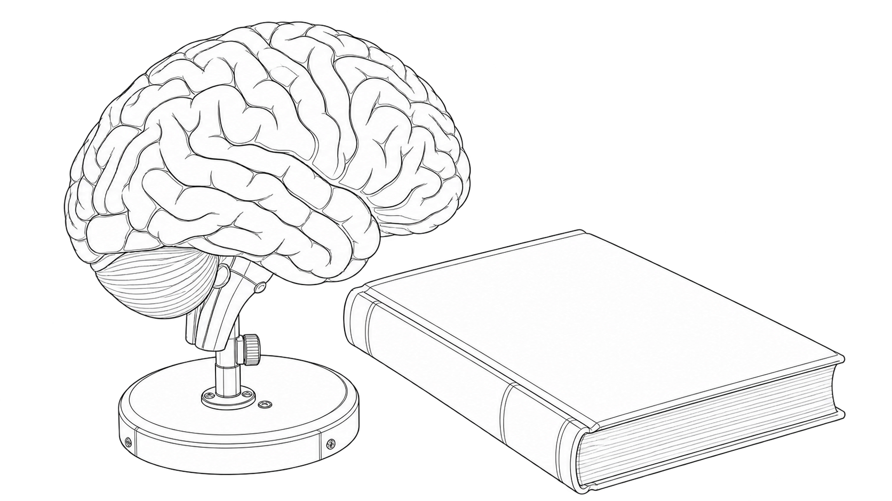
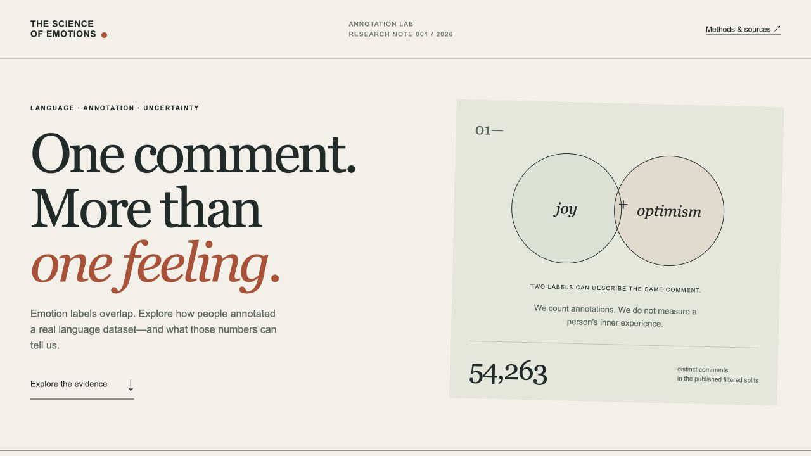
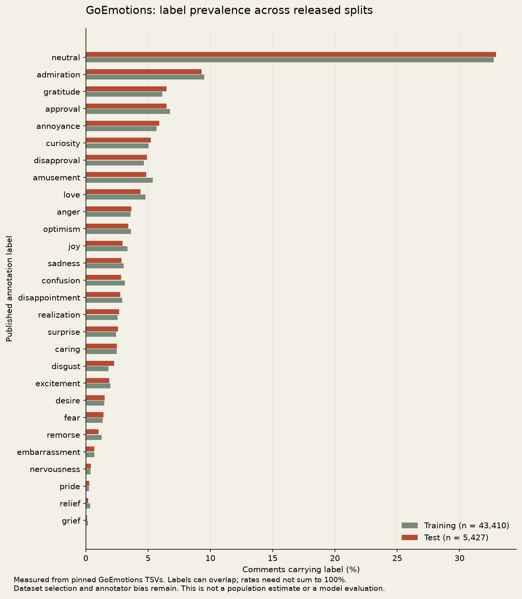

# The Science of Emotions



*Generated line-art concept illustration.*

A small research lab for a simple question: how do emotion labels overlap in real human annotations?



Explore measured GoEmotions label frequencies, label pairs, and differences across the official data splits. Reproduce the same report with Python. No account, model download, paid API, or Python dependency is needed for the main workflow.

## Run the lab

Requires Python **3.11 or newer**. Run from the repository root:

```sh
python3 scripts/serve.py
```

Open **http://127.0.0.1:8787/**. The viewer includes the measured aggregate report. Raw comments are not included or displayed. Select a split, click a label, and compare its overlap with another label. Each conditional rate shows its denominator.

## Repeat the experiment

```sh
python3 -m emotion_lab fetch --data-dir .data/goemotions
python3 -m emotion_lab analyze --data-dir .data/goemotions --check web/assets/report.json
```

The first command downloads about **4.4 MB** from four pinned official URLs and verifies SHA-256 hashes. The second command reproduces the committed report. To save a separate report, replace `--check` with `--out new-report.json`. Existing files are never overwritten. Source comments can contain problematic language; the pipeline validates them but does not publish them.

## Actual results

The full run on 27 October 2026 found **54,263 distinct comments**, **63,812 label assignments**, and **8,817 comments with multiple labels**. Also, **1,751 comments include neutral with another label**, so neutral is not treated as mutually exclusive.

In the test split, joy and optimism appear together in **7 comments**: 7/161 joy-labeled comments and 7/186 optimism-labeled comments. These are different conditional questions. Read the [methods and results](docs/methods.md) and [research guide](docs/research-guide.md).



## Verify and build

Node.js **22 or newer** is needed only for JavaScript checks.

```sh
python3 -m unittest discover -s tests -v
node --test tests/viewer.test.mjs
python3 scripts/build.py
```

The static viewer is written to `dist/`. It can be hosted as a plain static site; deployment is not part of this first build. To regenerate the optional figure, install `requirements-figures.txt` in a temporary virtual environment and run `python3 scripts/figure.py`.

## Evidence and limits

The lab analyzes released text annotations. It does not infer a person's inner state, diagnose, establish causes, or replicate the paper's BERT model. The data reflects its platform, language, selection, and annotator biases. Wilson intervals describe a binomial counting model; they do not establish population representativeness.

See the [data contract](docs/data-contract.md), [verification record](docs/verification.md), [contribution guide](CONTRIBUTING.md), and [security notes](SECURITY.md).

## Sources and history

Data: [Demszky et al., GoEmotions, ACL 2020](https://aclanthology.org/2020.acl-main.372/). The [locked source](data-source.json) records the exact revision, sizes, and hashes. GoEmotions data is Apache 2.0; its license and attribution are retained in [third-party notices](THIRD_PARTY_NOTICES.md).

This repository became The Science of Emotions on **27 October 2026**. The previous Android project is preserved on [`archive/before-science-of-emotions-2026-10-27`](https://github.com/ungaaaabungaaa/science-of-emotions/tree/archive/before-science-of-emotions-2026-10-27). Earlier history and stars predate this lab. The portfolio website remains unchanged.

MIT applies to the new project code. See [LICENSE](LICENSE).

## Export an accessible data table

```sh
python3 scripts/export_rates.py --split test --out test-rates.csv
```

Choose `train`, `dev`, `test`, or `all`. The new CSV preserves each label's count, comment denominator, rate, and 95% Wilson interval from the bundled measured report. It contains no raw comments or IDs and never overwrites an existing file. Rates are fractions; labels can overlap. The intervals describe the binomial model in the methods, not population uncertainty or model accuracy. This table can accompany exported figures or be read in a spreadsheet.

## Check sensitivity to rare labels

```sh
python3 scripts/rare_label_sensitivity.py --minimum-counts 1 10 50 --out rare-labels.json
```

For each released split and the pooled aggregate, this reports which labels meet each explicit minimum count, omitted label names, retained assignment counts, and their fraction of all label assignments. Total comment denominators remain unchanged. Assignment fractions are **not comment coverage** because labels overlap. The source aggregate is not filtered or rewritten. Thresholds are descriptive choices, without a statistical-significance or population claim. The JSON records the source-report hash and never overwrites an existing file.
